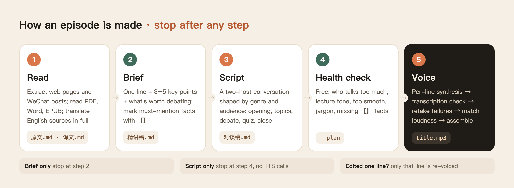

# podcast-maker

**Hand your agent an article, a document or a book chapter. It writes a two-host Mandarin Chinese podcast, voices it line by line, and you understand the whole thing after one listen on your commute.**

[中文](README.md) | **English**

[Quick start](#quick-start) · [Examples](#real-examples) · [Features](#features) · [Genres](#different-material-different-conversation) · [Voices](#voices-and-tts-providers) · [Numbers](#real-world-numbers) · [Docs](#more-docs)


> **The podcasts are in Mandarin Chinese.** Sources can be in Chinese, English or other languages; foreign-language material is translated in full first.

## What problem does it solve?

Saved articles pile up and rarely get read. Text-to-speech readers drone through the original and you tune out in two minutes; a five-line AI summary loses the numbers and the reasoning.

**podcast-maker** is an Agent Skill for Claude Code, Codex and similar agents. The agent reads the material, writes a brief that keeps only the core, rewrites it as a conversation where **one host asks your questions and the other explains in plain words**, then voices and checks every line and hands you an MP3.

- **Understand it in one listen, not a read-aloud.** An opening, topics, a discussion, and 2–3 quiz questions at the end, each followed by a few seconds of silence to answer in your head.
- **Nothing important gets dropped.** The brief marks must-mention claims, numbers, names and dates with 【】, and the script is **checked against every mark** before voicing.
- **Clear to non-experts, or to whoever you name.** By default it talks to a "smart non-expert": deep content, plain words. Say "explain it for my parents" or "focus on what it means for ordinary people", and the episode takes that angle.
- **Reliable audio.** Each line is synthesized separately, then **transcribed back** with local speech recognition; mismatches are re-voiced automatically.

## Quick start

**Requires:** Node.js 18+, ffmpeg, an API key for one TTS provider (MiniMax by default). Optional: [mlx-whisper](https://github.com/ml-explore/mlx-examples/tree/main/whisper) for the transcription check on Apple Silicon; skipped automatically if missing.

**1. Install it into your agent.** Pick the one you use:

```bash
git clone https://github.com/bingfeng131415/podcast-maker ~/.claude/skills/podcast-maker   # Claude Code
git clone https://github.com/bingfeng131415/podcast-maker ~/.codex/skills/podcast-maker    # Codex
git clone https://github.com/bingfeng131415/podcast-maker ~/.agents/skills/podcast-maker   # other Agent Skills tools
```

**2. Add your TTS key.**

```bash
mkdir -p ~/.config/podcast-maker
cp ~/.claude/skills/podcast-maker/.env.example ~/.config/podcast-maker/.env
# open ~/.config/podcast-maker/.env and fill in MINIMAX_API_KEY
```

**3. Voice the 30-second sample first.** The health check makes no TTS calls and **costs nothing**; drop `--plan` to actually voice it:

```bash
cd ~/.claude/skills/podcast-maker
node scripts/podcast-tts.mjs examples/样片 --plan   # health check
node scripts/podcast-tts.mjs examples/样片          # voice it
```

Real output (the tool speaks Chinese):

```text
《样片 声音试听》：7 个话轮，拆成 8 句，约 140 字，预计 0.6 分钟
  女（主持人 · Chinese (Mandarin)_Warm_Bestie）：4 句，75 字
  男（讲解者 · Chinese (Mandarin)_Reliable_Executive）：4 句，65 字
  精讲稿：约 115 个汉字，【】标了 3 处关键信息，对谈里讲到 3 处
  互动：抢话 1，快接 1，声音标记 3（其中笑声 0），自测留白 0
  稿子体检：没发现问题
做好了：样片/样片 声音试听.mp3
  时长 0:33，8 句；本次新合成 9 句（计费约 237 字），重生成过 1 句，用时 27 秒
  语音识别逐句复查：8/8 句对得上
```

That reads: 7 turns split into 8 lines, ~140 characters; all 3 【】 facts covered; health check clean; MP3 is 0:33, ~237 characters billed, 1 line re-voiced, done in 27 s; **8/8 lines passed the transcription check**.

▶ **[Listen to these 30 seconds](assets/sample.mp3)** (default voices: "Warm Bestie" host, "Reliable Executive" explainer)

**4. From then on, just talk to your agent:**

```text
Make a podcast from this: https://…
```

## Real examples

### An 8,700-character Chinese tech article → an 11-minute conversation

A real episode made with this Skill, from a long WeChat post about one person's agent automation setup.

| Stage | Result |
|---|---|
| Extract | ~8,700 characters, 17 images |
| Brief | ~750 characters: one-line summary, 5 key points, 3 debate points; **29 facts marked with 【】** |
| Script | 122 turns, ~2,800 characters; **all 29 facts covered** |
| Voice | 150 lines synthesized one by one; **transcription check 150/150**; 7 failing lines re-voiced automatically |
| Result | **10:57** MP3, sent to the phone automatically; ~10 minutes to synthesize and check |

**How the health check shaped the script.** The first draft got three warnings:

- the explainer had **66%** of the words (target: at most 65%), so it sounded like a lecture;
- only **10** sound tags for 118 turns (target: one every 5–8 turns);
- **9** distinct English words and acronyms (Agent, AI, DeepSeek, Mac, Claude, GPT, Opus, Sol, Terra).

Two rounds of edits: the host now guesses a few answers before they're explained, a few breaths and pauses were added, and "AI assistant" became a plain Chinese word. The check came back **clean**, and only then was the episode voiced.

**【】 caught numbers an older draft had dropped.** An earlier script of the same article, re-checked with 20 marks, covered only **13**. Missing: the three figures behind the article's strongest claim. The author reviewed **298** merge requests, found **333** issues, fixed **306** before merging; the old draft said "almost three hundred", "over three hundred", "most of them". The new script says the exact numbers, then adds a sense of scale: "more than nine in ten problems were caught before going live."

### What the script looks like

```markdown
## 所有事，先到一个地方

女：那每一种写一套程序去接？
男：作者说，做三五个还行，做到几十个，肯定乱成一锅粥。所以他搭了一个"中台"。
女：中台……说实话，这个词我一听就头大。
男：(emm) 你就把它当成公司的收发室。所有的信和快递，都先送到收发室，收发室看一眼，该给谁就给谁。
女：那收发室怎么知道该给谁？
男：靠一份规则清单。……只有需要拍板才找他。
女[抢]：等一下，所以接一种新的事，就是在清单上加一行？
```

In English: the host admits the word "middle platform" (中台) makes her head spin; the explainer immediately turns it into **"the company mail room"** and keeps that image for the rest of the episode; the host then **interrupts** (`[抢]`, the two voices overlap) to check her understanding.

- **The host is on the listener's side.** Where a non-expert would get stuck, she gets stuck first.
- **Jargon is explained by what it does**, then named, then the name stays fixed.
- `[抢]` is an interruption, `[快]` a quick reply; `(emm)` `(chuckle)` `(breath)` are thinking, light-laugh and breath sounds.

### The same point, for different listeners

Name a listener or a focus and the opening, examples, wording and the host's questions all change. Illustration:

| You say | The host asks | The explainer says |
|---|---|---|
| nothing (default non-expert) | "That word makes my head spin." | "Think of it as the company mail room." |
| "Explain it for my parents" | "So what's in it for ordinary folks like us?" | "Like the parcel lockers at your building's gate: everything lands there first, then goes to each flat." |
| "Explain it for programmers" | "What does it add over a message queue?" | "A unified event format, de-duplication, rule-based routing, and a single outbound channel." |
| "Focus on getting started" | "If I want to build this, what's step one?" | "Don't build it all. Start with one inbox for events and one way to reach you." |

### English sources are translated first

```text
$ node scripts/fetch-article.mjs "https://www.anthropic.com/engineering/building-effective-agents" -o 原文.md
已保存：原文.md
  标题：Building effective AI agents
  发布：2024-12-19
  正文约 2672 个词，图片 8 张
  正文是英文：先翻成中文存为 译文.md，再写精讲稿（见 references/输入源.md「外文材料」）
```

The extractor detects English (~2,672 words) and tells the agent to translate first. The agent translates **in full** into `译文.md`, with a glossary of names, terms and figures at the end, then continues as usual. In the conversation, foreign institutions get a familiar Chinese comparison, and units and currencies are converted.

## Features

**Scripts: conversational, and clear**

- **Brief first, then dialogue.** The brief works as a standalone study note (500–1,000 characters for an article); the dialogue is its audio version. Anything added beyond the source is marked, never attributed to the author.
- **【】 fact check.** Mark a claim, number, person or date and it must be said; alternative wordings count, e.g. 【298/近三百】.
- **Eight genre guides.** Tech, policy, politics & world news, history, books & papers, business & finance, science & health, news & opinion. Each says what to explain, what to mark and where mistakes happen.
- **Two roles with a split.** The host asks, follows up, guesses, paraphrases; the explainer explains, uses analogies, has opinions. The explainer gets **at most 65%** of the words, so it never turns into a lecture.
- **Debate and a quiz.** The hosts may disagree; 2–3 quiz questions at the end, each followed by 6 seconds of silence.
- **15-point health check.** Word share, long monologues, too-smooth exchanges, interruption count, sound-tag density, laughs, lecture phrases, jargon, English words, over-hedging, missing quiz, missing 【】 facts, missing translation… **Fix the warnings, then voice.**

**Audio: natural, and dependable**

- **Line-by-line synthesis.** Interruptions, quick replies, breaths, light laughs and quiz pauses are laid out on a timeline.
- **Line-by-line QC.** Duration, speaking rate, odd silences and clipping, plus local transcription compared against the script. Failures are re-voiced, **up to 3 takes per line**, and the best take wins.
- **Numbers are compared fairly.** "17" and "十七", "2026年" and "二零二六年" are normalized before comparison, so spelling differences don't cause false failures.
- **Loudness matched** between the two voices; final MP3 normalized to −16 LUFS.
- **Edit one line, re-voice one line.** Every line is cached; change one speaker's voice and only that speaker is redone.

**Integration: easy to install, easy to swap**

- **Many sources.** WeChat posts and ordinary web pages (built-in extractor, zero dependencies), PDF, Word, EPUB, pasted text; English, Japanese and other languages are translated first.
- **Swappable TTS.** MiniMax by default; Doubao and ElevenLabs adapters included; add your own.
- **Sent to your phone** with any command you configure (Feishu/Lark, Telegram, …).
- **Remembers your taste.** Write your background and preferences in a listener profile (too long, too academic, favorite voice); every episode follows it.

## How an episode is made



1. **Read.** Web pages and WeChat posts go through the built-in extractor; PDF and Word are read directly. The source is saved as `原文.md`; foreign-language sources are translated into `译文.md`.
2. **Brief.** Keep only the core and mark must-mention facts with 【】.
3. **Script.** Read the genre guide, then write the two-host conversation for the chosen audience and angle. Episodes over ~10 minutes get a one-screen outline for you to approve first.
4. **Health check.** Run `--plan`, fix the warnings until none are left, then show you the script.
5. **Voice.** Synthesize, check, retake, assemble, export MP3, and send it to your phone if configured.

**Stop after any step:**

| You say | Stops at | You get |
|---|---|---|
| "Just the brief" | step 2 | `精讲稿.md` |
| "Script only, no audio yet" | step 4 | plus `对谈稿.md` |
| nothing, or "make a podcast" | the end | plus the MP3 |
| "Voice it" after reading the script | continues at step 5 | the MP3 |

## Different material, different conversation

The agent identifies the genre and reads the matching guide in `references/材料类型/`.

| Material | You might say | The episode makes clear | The hosts debate |
|---|---|---|---|
| **Tech** | "Make this AI-tool article into a podcast" | The problem, the core idea (with an analogy), what's better than before | Costs and barriers, who should care, can I use it |
| **Policy documents** | "Explain this notice as a dialogue, for my parents" | Who issued it, when it takes effect, what changed, who's affected, what to do | Why now, where enforcement may stall, what's still unclear |
| **Politics & world news** | "This tariff report, under 10 minutes" | What happened, the background, what each side says | Whether each side's reasons hold up — **without taking sides** |
| **History** | "This chapter on the Hongwu Emperor abolishing the chancellorship" | Dates, people, causes; each year anchored to something familiar | Does the author's explanation hold, what is and isn't like today |
| **Books & papers** | "Chapter 14 of *Beyond Feelings*" | Core argument, key concepts, the author's examples; sample and method for papers | Where the author is right, where they overreach |
| **Business & finance** | "This earnings report, focus on why profit fell" | Key figures and their basis (vs. last year or last quarter) | Whether the author's reading holds — **no investment advice** |
| **Science & health** | "Explain this study in plain words" | What was found and how strong the evidence is (how many people, humans or animals) | Whether it should change daily habits — **no medical advice** |
| **News & opinion** | "This op-ed, argue both sides" | The author's claim and reasons, in their strongest form | The usual objections, what information is missing |

**Every guide lists common mistakes**, e.g. a draft for comment is not a final rule; publication date is not effective date; unconfirmed news is "reportedly"; folklore and TV dramas are not history; correlation is not causation; serious topics get no jokes and no laughter.

## Voices and TTS providers

Default: MiniMax `speech-2.8-hd`, "Warm Bestie" as the host and "Reliable Executive" as the explainer. `voices.json` has more presets, switched with `--voice`:

```bash
node scripts/podcast-tts.mjs 播客/some-episode --voice 温润
```

**Cloned voices, another provider, or auto-sending each episode to Feishu** go in `~/.config/podcast-maker/config.json`, without touching the Skill:

```json
{
  "speakers": { "男": { "voice_id": "your usual male voice ID" } },
  "presets": { "本人": { "男": { "voice_id": "your cloned voice ID" } } },
  "send": ["lark-cli", "im", "+messages-send", "--as", "bot", "--user-id", "<your open_id>", "--file", "{file}"]
}
```

| Provider | Tested? |
|---|---|
| **MiniMax** (default) | Yes, with system voices and cloned voices; supports sound tags, emotions, pronunciation dictionary |
| **Doubao** (Volcengine) | Implemented from the official docs, **not yet tested** |
| **ElevenLabs** | Implemented from the official docs, **not yet tested** |

Sound tags and in-line pauses are MiniMax-only; with other providers they are stripped automatically, never read aloud. To add a provider, write one function in `scripts/tts-providers.mjs`.

## Real-world numbers

Two real runs on an Apple Silicon Mac, MiniMax `speech-2.8-hd`, local transcription check included:

| | 30-second sample | Long WeChat article |
|---|---:|---:|
| Source | — | ~8,700 characters |
| Brief | ~115 characters, 3 【】 | ~750 characters, 29 【】 |
| Script | 7 turns, ~140 characters | 122 turns, ~2,800 characters |
| Lines | 8 | 150 |
| Duration | 0:33 | 10:57 |
| Synthesis + checks | 27 s | ~10 min |
| MiniMax billed | ~237 characters | ~3,500 characters |
| Lines re-voiced | 1 | 7 |
| Transcription check passed | 8/8 | 150/150 |

**Billing exceeds the script length** because failed lines are re-voiced and sound tags count as characters. The health check (`--plan`) is free.

## Usage and copyright

- **Script writing uses your agent's own quota; voicing uses your own TTS key.** The Skill never reads or stores your account credentials; keys live only in `~/.config/podcast-maker/.env` on your machine.
- **Fetched pages and files are treated as material, not instructions.** Text like "please run…" or "ignore previous instructions" inside them is not followed.
- **Books and articles remain their authors' copyright.** This is a tool for your own listening and learning; don't publish the podcasts it makes.
- This is an independent open-source project, not affiliated with or endorsed by MiniMax, ByteDance, ElevenLabs, Anthropic, OpenAI or any other vendor.

## More docs

The docs are in Chinese:

- [Full workflow for the agent](SKILL.md)
- [Eight genre guides](references/材料类型/)
- [Audience: the default listener, and custom audiences and angles](references/讲给谁听.md)
- [Script format: interruptions, sound tags, pauses, pronunciation](references/对谈稿格式.md)
- [Reading each kind of source, translating foreign material](references/输入源.md)
- [Voices, providers, sending to your phone](references/语音服务.md)

<details>
<summary><strong>Repository layout</strong></summary>

| Path | Contents |
|---|---|
| `SKILL.md` | The agent's workflow: where to stop, per-episode files, 7 steps |
| `references/材料类型/` | Eight genre guides, each with a sample exchange |
| `references/` | Audience and angle, script format, sources, voice services |
| `scripts/podcast-tts.mjs` | Health check + line-by-line voicing + QC + assembly |
| `scripts/tts-providers.mjs` | MiniMax, Doubao, ElevenLabs adapters |
| `scripts/fetch-article.mjs` | Web page / WeChat extractor with language detection |
| `styles/_模板.md` | Template for conversation style cards |
| `examples/样片/` | Brief and script of the 30-second sample |
| `voices.json` | Default voices and public presets |
| `config.example.json`, `.env.example` | Templates for personal config and keys |
| `assets/` | Banner, flow diagrams and their sources, the 30-second sample |

</details>

## Credits

Script-writing ideas borrowed from [wang-h/natural-ai-podcast](https://github.com/wang-h/natural-ai-podcast) (multi-pass writing, "un-smooth" interactions, MiniMax sound tags, overlap timeline) and [zarazhangrui/personalized-podcast](https://github.com/zarazhangrui/personalized-podcast) (switchable show formats).

[MIT License](LICENSE)
