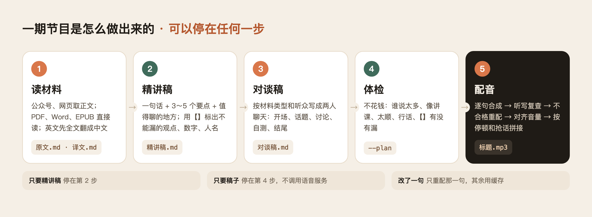

<div align="center">

# 🎙️ podcast-maker

**丢给你的 Agent 一篇文章、一段视频、一份文件，或者只说一个主题，<br>它写成两个人聊天的中文播客，逐句配好音，路上听一遍就懂。**

**中文** | [English](README.en.md)

[](LICENSE)
[](#-上手)
[](https://nodejs.org)
[](#-声音和语音服务)
[](https://github.com/bingfeng131415/podcast-maker/stargazers)
[](https://github.com/bingfeng131415/podcast-maker/commits/main)

[⚡ 上手](#-上手) • [💡 场景示例](#-场景示例) • [📥 能读什么](#-能读什么) • [✨ 特点](#-特点) • [🆚 和 NotebookLM 比](#-和-notebooklm-比) • [📊 实测数据](#-实测数据) • [❓ 常见问题](#-常见问题)

</div>


## 🎯 这是什么？

一个给 Claude Code、Codex 这类 Agent 用的 **Skill**。你用一句话交代，它把材料读透、写稿、体检、配音，交给你一个 MP3：

```
你说：把这篇公众号做成播客
它做：✅ 11 分钟双人对谈 → MP3（29 处关键信息全部讲到）

你说：这期小宇宙讲 AI 编程的，帮我精讲一下
它做：✅ 76 分钟节目，本机 4 分半转成 2.2 万字文字稿 → 接着写稿、配音

你说：做一期讲"人工智能+"行动的，讲给外行听
它做：✅ 搜到 3 份官方材料 → 列给你确认 → 6:30 的对谈，附章节、自测题、闪卡
```

收藏夹里的文章越攒越多，真正读完的很少。用朗读软件念原文，又干又长，听两分钟就走神；让 AI 总结成几行字，关键数字和来龙去脉又都没了。**podcast-maker 的做法是：一个人替你提问，一个人用大白话讲清楚。**

- **听一遍就懂，不是念原文。** 有开场、有话题、有讨论，结尾 2～3 道自测题，每题后面留几秒让你在心里答。
- **核心一个不漏。** 精讲稿里用【】标出必须讲到的观点、数字、人名、日期，配音前**逐个检查**对谈里有没有说到。
- **外行听得懂，也能指定讲给谁。** 默认讲给"聪明的外行"：内容可以深，话要浅。说"讲给我爸妈听""侧重对普通人的影响"，这一期就换这个角度。
- **配音靠得住。** 每句单独合成，再用本机语音识别**逐句听写**，和原文对不上的自动重配。

## ⚡ 上手

**需要：** Node.js 18 以上、ffmpeg、一家语音服务的密钥（默认 [MiniMax](https://platform.minimaxi.com)）。可选：[mlx-whisper](https://github.com/ml-explore/mlx-examples/tree/main/whisper)（Apple 芯片的 Mac 上做听写复查、音视频转文字）、[yt-dlp](https://github.com/yt-dlp/yt-dlp)（YouTube、B 站）。

**1. 装进你的 Agent**（选你用的那个）

```bash
git clone https://github.com/bingfeng131415/podcast-maker ~/.claude/skills/podcast-maker   # Claude Code
git clone https://github.com/bingfeng131415/podcast-maker ~/.codex/skills/podcast-maker    # Codex
git clone https://github.com/bingfeng131415/podcast-maker ~/.agents/skills/podcast-maker   # 其他支持 Agent Skills 的工具
```

**2. 填密钥，跑一遍环境检查**

```bash
mkdir -p ~/.config/podcast-maker
cp ~/.claude/skills/podcast-maker/.env.example ~/.config/podcast-maker/.env   # 打开它，填 MINIMAX_API_KEY
node ~/.claude/skills/podcast-maker/scripts/doctor.mjs --online               # 看缺什么、密钥能不能用（不计费）
```

输出节选（✓ 有了，✗ 必须补，○ 可选，每项都给出补法）：

```text
必需
  ✓ Node.js 25.8.0
  ✓ ffmpeg（ffmpeg）
  ✓ minimax 密钥已设置
可选
  ✓ mlx-whisper：配音后逐句听写复查、音视频转文字
  ✓ yt-dlp：YouTube、B 站等视频
  ○ 没有听众档案：写稿时不知道你的背景和偏好
      → cp ".../听众档案.example.md" "~/.config/podcast-maker/听众档案.md"，再按自己的情况改
连接测试
  ✓ MiniMax 连得上，密钥有效（系统音色 327 个）
必需的都齐了，可以开始做播客。
```

**3. 先配 30 秒样片，听听声音**

```bash
cd ~/.claude/skills/podcast-maker
node scripts/podcast-tts.mjs examples/样片 --plan   # 体检，不花钱
node scripts/podcast-tts.mjs examples/样片          # 配音
```

```text
做好了：样片/样片 声音试听.mp3
  时长 0:33，8 句；本次新合成 9 句（计费约 237 字），重生成过 1 句，用时 27 秒
  语音识别逐句复查：8/8 句对得上
```

▶ **[试听这 30 秒](assets/sample.mp3)**（默认声音：女声"温暖闺蜜"，男声"沉稳高管"）

**4. 之后直接对 Agent 说话就行。**

## 💡 场景示例

下面的输出都来自真实运行，只有场景 4 是示意。

### 场景 1：公众号长文 → 11 分钟对谈

```
你：把这篇做成播客 https://mp.weixin.qq.com/s/……

Agent：
  ✓ 取正文：约 8700 字，17 张图
  ✓ 精讲稿：约 750 字，5 个核心要点，【】标了 29 处关键信息
  ✓ 对谈稿：122 个话轮，第一遍体检 3 条提示 → 改两轮 → 没发现问题
  ✓ 配音：150 句，听写复查 150/150 句对得上，7 句不合格自动重配
✅ MP3（10:57，9 个章节）+ 节目单 + 自测 + 闪卡，已发到飞书
```

第一遍体检给的提示，和改稿前后：

```text
  稿子体检，建议先改再配音：
    · 男说了 66% 的字，像讲课。把一部分内容改成另一个人先猜、先说、复述（目标：不超过 65%）
    · 声音标记只有 10 个，偏少（大约每 5～8 个话轮一个）
    · 英文词和缩写有 9 个（Agent、AI、DeepSeek、Mac、Claude、GPT、Opus、Sol、Terra）：能用中文说的就换掉
```

**【】还查出了旧稿漏讲的数字。** 原文写"审了 **298** 个合并请求，报了 **333** 条问题，**306** 条在合并前修掉"，旧稿只说"快三百个""三百多个""绝大部分"：

```text
  精讲稿：约 662 个汉字，【】标了 20 处关键信息，对谈里讲到 13 处
    · 精讲稿里标的这些，对谈稿里没出现：【三五个】【领活】【GPT-6.1 Terra】【指挥的模型必须最聪明】【298】【333】【306】
```

### 场景 2：一期 76 分钟的小宇宙节目 → 文字稿 → 精讲

```
你：这期讲 AI 编程的，帮我精讲一下 https://www.xiaoyuzhoufm.com/episode/……

Agent：
  ✓ 从页面找到音频，下载（1:15:59），节目简介一起存下
  ✓ 本机 mlx-whisper 转写：下载加转写共 4 分 34 秒，约 2.2 万字，每段带时间点
  ✓ 按话题重新组织成精讲稿，不按时间顺序复述 → 之后和场景 1 一样
```

```text
[0:14] 各位听众大家好，这是一期科技乱顿的特集。为什么叫特集呢？……
```

转写**不区分说话人，也会有错字**（上面把《科技乱炖》听成了"科技乱顿"）。所以 Skill 会让 Agent 对照节目简介核对人名和术语，拿不准的不写进【】。

### 场景 3：只说一个主题 → 搜资料 → 多篇合成一期

```
你：做一期讲"人工智能+"行动的，讲给外行听

Agent：
  ✓ 搜索，挑出 3 份材料写进 来源清单.md，列给你确认：
      ① 国务院《关于深入实施"人工智能+"行动的意见》原文（2025-08-21）
      ② 国家发展改革委负责人答记者问（新华社，08-26）
      ③ 国家发展改革委新闻发布会（新华社，08-29）
  ✓ 按"政策文件"的写稿说明写：先讲清是什么级别的文件、要不要老百姓办事
  ✓ 精讲稿按话题组织，每个要点注明出自哪篇；【】20 处，对谈里全部讲到
  ✓ 第一遍体检：抢话只有 1 处、声音标记偏少 → 改一轮 → 没发现问题
✅ 人工智能+行动的意见，跟你有什么关系.mp3（6:30，8 个章节）
```

自动生成的 `节目单.md`：

```markdown
# 人工智能+行动的意见，跟你有什么关系

时长 6:30

国务院发了一份意见，给人工智能进各行各业定了方向和时间表：到2027年智能终端、智能体这些应用的普及率超过70%。

## 章节

- 0:00 开场
- 0:33 这是一份什么文件
- 1:06 三个时间点，两个数字
- 2:11 六件事，八个支撑
- 3:33 发布会说了什么具体的
- 4:26 我们怎么看
- 5:22 自测
- 6:15 结尾

## 自测

1. 文件定的2027年目标，普及率是多少？
2. "6加8"里的6，指的是哪六个领域？说出三个就行。
3. 为什么说这份文件，不用老百姓马上去办什么？

答题思路见 自测.md。

## 来源

- [国务院关于深入实施“人工智能+”行动的意见](https://www.cac.gov.cn/2025-08/27/c_1758018277755538.htm)
- [为加快培育发展新质生产力、推动高质量发展提供新动能——解读《关于深入实施“人工智能+”行动的意见》](https://www.news.cn/politics/20250826/5f6c013ecf1d4cf5b2da5231b34b861b/c.html)
- [扩内需有何新举措？如何实施好“人工智能+”行动？——国家发展改革委解读当前经济热点](https://www.news.cn/fortune/20250829/0ce1919797fa43e8adf3c2131546b798/c.html)
```

### 场景 4：同一个点，讲给不同的人（示意）

说一句"讲给谁听"或"侧重什么"，开场、例子、用词、主持人的问题都会跟着换：

| 你说 | 主持人会这样问 | 讲解者会这样讲 |
|---|---|---|
| 没说（默认外行） | "中台这个词我一听就头大。" | "你就当它是公司的收发室。" |
| "讲给我爸妈听" | "那这东西，对我们老百姓有啥用？" | "就像小区门口的快递柜，东西先到这儿，再分到各家。" |
| "讲给程序员听" | "它跟消息队列比，多做了什么？" | "统一的事件格式、去重、按规则路由，再加一个出口。" |
| "侧重怎么上手" | "我要是想照着搭，第一步干嘛？" | "先别搭全套，就做一个收事的地方和一个找你的出口。" |

### 场景 5：英文材料 → 先翻译，再走同样的流程

```text
$ node scripts/fetch-article.mjs "https://www.anthropic.com/engineering/building-effective-agents" -o 原文.md
  标题：Building effective AI agents
  正文约 2672 个词，图片 8 张
  正文是英文：先翻成中文存为 译文.md，再写精讲稿（见 references/输入源.md「外文材料」）
```

Agent 会**全文翻译**成 `译文.md`，末尾附人名、术语、数字对照表；对谈里，外国的制度找一个国内的对照，单位和钱换算成你熟悉的。

### 场景 6：一次好几个链接，各做一期

```
你：这三篇都做成播客：链接1 链接2 链接3
```

每个链接一个文件夹；先把三期稿子都写完、体检通过，再在后台**一期接一期**地配音（同时配会撞上语音服务的频率限制），做完列一张表：每期的时长、位置、需要留意的句子。

## 📥 能读什么

<table>
<tr>
<td width="50%" valign="top">

### 📰 文章和网页
- **微信公众号**（自带提取脚本，零依赖）
- **任意公开网页**：新闻、博客、文档
- **英文、日文等外文**：先全文翻成中文
- **只说一个主题**：先搜资料、选来源

### 🎧 音频和视频
- **小宇宙**等播客网页（从页面找音频）
- **YouTube**（先用视频字幕，没有再转写）
- **B 站、喜马拉雅**（用 yt-dlp 下载）
- **本地录音和视频**：mp3、m4a、wav、mp4、mov……

</td>
<td width="50%" valign="top">

### 📚 书和文件
- **PDF**（长的只读指定范围）
- **Word**（.docx）
- **EPUB** 电子书
- **Markdown、纯文本、直接贴的文字**

### 🧩 组合方式
- **一篇做一期**
- **几篇合成一期**：按话题组织，对照各家说法
- **好几篇各做一期**：批量排队配音

> 🔒 要登录、付费、会员才能看的内容不去绕过，请自己导出文件交给它。

</td>
</tr>
</table>

## 🎁 能拿到什么

| 产出 | 用来干嘛 | 你可以这么说 |
|---|---|---|
| 📝 **精讲稿** `精讲稿.md` | 扫一眼就知道核心，能当学习笔记 | "只要精讲稿""先帮我理解一下" |
| 💬 **对谈稿** `对谈稿.md` | 两人对谈的逐字稿，可以自己改 | "出个稿子""先不配音" |
| 🎙️ **播客** `标题.mp3` | 开车、走路时听；每个话题一个**章节**，支持章节的播放器能直接跳 | "做成播客"（默认） |
| 🗒️ **节目单** `节目单.md` | 一句话、章节时间点、自测题、来源链接 | 配音时自动生成 |
| ❓ **自测题** `自测.md` | 题目和答题思路，答案默认折叠 | 配音时自动生成 |
| 🃏 **闪卡** `闪卡.csv` | 直接导入 Anki 等闪卡软件 | 配音时自动生成 |

可以停在任何一步；稿子看完说一句"配音吧"，就从停下的地方接着做。



## ✨ 特点

**📝 稿子：像聊天，也讲得清楚**

- **先精讲，再对谈。** 精讲稿只留核心（一篇文章 500～1000 字），补充的内容会标出来，不会说成作者的意思。
- **【】关键信息检查。** 关键观点、数字、人物、日期，标了就必须讲到；换了说法也认，比如【298/近三百】。
- **按材料类型写。** 技术、政策、时政、历史、书和论文、商业财经、科学健康、新闻观点，**8 份写稿说明**，各自规定该讲什么、该标什么、哪里容易出错。
- **两个角色有分工。** 主持人提问、追问、先猜答案、复述；讲解者讲清楚、打比方、有自己的判断。讲解者的字数**不超过 65%**。
- **体检 15 项。** 字数占比、独白太长、对话太顺、抢话多少、声音标记、笑声次数、讲稿腔、行话、英文词、交代太多、没有自测、【】有没有漏、外文有没有译文……**有提示就先改，改完再配音。**

**🎙️ 配音：自然，也靠得住**

- **逐句合成。** 抢话、快接、换气、轻笑、自测留白，都在时间线上拼出来。
- **逐句质检。** 查时长、语速、异常空白、削波，再用本机语音识别听写一遍；对不上的自动重配，**每句最多 3 版**，选最好的。
- **数字也会核对。** "17"和"十七"、"2026 年"和"二零二六年"按同一个读法比较，不会误判。
- **两个声音音量对齐**，统一响度（-16 LUFS）导出 MP3。
- **改一句只重配一句。** 每句都有缓存；换了某个人的声音，只重配那个人。

**🧩 接入：好装，好换**

- **一条命令查环境。** `doctor.mjs` 告诉你缺什么、怎么补，`--online` 再确认密钥能用（不计费）。
- **语音服务可换。** 默认 MiniMax，内置豆包、ElevenLabs 的接入，也可以自己加一家。
- **做完发到手机。** 配一条发送命令，飞书、Telegram 都行。
- **记住你的偏好。** 听众档案里写你的背景和喜好，以后每期都照着写。

## 📚 不同的材料，聊法不一样

| 材料 | 你可以这么说 | 节目重点讲清楚 | 拿来讨论的 |
|---|---|---|---|
| **技术文章** | "把这篇 AI 工具的文章做成播客" | 解决什么问题、核心做法（打比方）、和以前比好在哪 | 代价和门槛、谁该关心、能不能用上 |
| **政策文件** | "把这个通知解读成对谈，讲给我爸妈听" | 谁发的、哪天生效、改了什么、影响谁、要做什么 | 为什么现在出、执行会卡在哪、还有什么没说清 |
| **时政国际** | "这篇关税的报道，做成 10 分钟以内的" | 发生了什么、背景、各方怎么说 | 各方理由站不站得住，**不替听众站队** |
| **历史** | "这一章讲朱元璋废丞相的，做成播客" | 时间、人物、因果；年份配一个你熟悉的参照 | 作者的解释站不站得住、和今天哪里像哪里不像 |
| **书和论文** | "Beyond Feelings 第 14 章，出一期" | 核心论点、关键概念、作者的例子；论文讲清样本和方法 | 作者哪里说得对、哪里说过头 |
| **商业财经** | "这份财报，侧重为什么利润下滑" | 关键数字和口径（跟去年比还是跟上季度比） | 作者的判断有没有道理，**不给投资建议** |
| **科学健康** | "这项研究讲得通俗点" | 发现了什么、证据多硬（多少人、在人身上还是动物身上） | 能不能改变日常做法，**不给医疗建议** |
| **新闻观点** | "这篇评论，正反两方都聊聊" | 作者的主张和理由，先讲到最有说服力 | 最常见的反对意见、还缺什么信息 |

**每份说明都写了"容易出错"的地方。** 比如：征求意见稿不能说成正式稿，发布日期和生效日期要分清；没证实的消息要说"据报道"；野史不能当史实；相关不能说成因果；严肃话题不开玩笑。

## 🆚 和 NotebookLM 比

[NotebookLM](https://notebooklm.google.com/) 的"音频概览"也能把材料变成播客，两个各有长处：

| | NotebookLM 音频概览 | podcast-maker |
|---|---|---|
| **在国内用** | 需要能访问 Google 服务 | 用国内的 MiniMax 就行 |
| **稿子** | 不能逐句看、逐句改 | 精讲稿、对谈稿都是文件，**改一句只重配一句** |
| **关键信息** | 讲什么由模型决定 | 【】标出必须讲的，配音前**逐个检查** |
| **讲法** | 可以写提示调整重点 | 8 类材料的写稿说明 + 指定听众和角度 |
| **声音** | 固定的几个 AI 声音 | 选音色、换服务商、**用你自己的克隆声音** |
| **质检** | — | 体检 15 项 + 逐句听写复查 |
| **花费** | 免费版有次数限制 | 写稿用你 Agent 的额度；配音按字数付费（11 分钟约 3500 字） |
| **其他格式** | 思维导图、学习卡片、视频等 | 只做播客，附节目单、自测、闪卡 |

**想要多种格式、零配置，用 NotebookLM；想要中文对谈讲得准、稿子自己能掌控，用 podcast-maker。**

## 🔊 声音和语音服务

默认用 MiniMax `speech-2.8-hd`：女声"温暖闺蜜"做主持人，男声"沉稳高管"做讲解者。`voices.json` 里还有几套预设，用 `--voice` 切换：

```bash
node scripts/podcast-tts.mjs 播客/某一期 --voice 温润
```

**用自己克隆的声音、换服务商、每期做完自动发到飞书**，写在 `~/.config/podcast-maker/config.json` 里，不用改 Skill：

```json
{
  "speakers": { "男": { "voice_id": "你常用的男声音色 ID" } },
  "presets": { "本人": { "男": { "voice_id": "你克隆的声音 ID" } } },
  "send": ["lark-cli", "im", "+messages-send", "--as", "bot", "--user-id", "<你的 open_id>", "--file", "{file}"]
}
```

| 服务商 | 实测情况 |
|---|---|
| **MiniMax**（默认） | 跑通了系统音色和克隆声音，支持声音标记、情绪、发音词典 |
| **豆包**（火山引擎） | 按官方文档接入，**还没有实测** |
| **ElevenLabs** | 按官方文档接入，**还没有实测** |

## 📊 实测数据

Apple 芯片的 Mac，MiniMax `speech-2.8-hd`，含本机听写复查：

| | 30 秒样片 | 公众号长文 | 只给主题（政策） |
|---|---:|---:|---:|
| 材料 | — | 1 篇，约 8700 字 | 3 篇，约 9900 字 |
| 精讲稿 | 约 115 字，3 处【】 | 约 750 字，29 处【】 | 约 600 字，20 处【】 |
| 对谈稿 | 7 个话轮 | 122 个话轮，约 2800 字 | 74 个话轮，约 1600 字 |
| 成品时长 | 0:33 | 10:57 | 6:30 |
| 合成 + 复查用时 | 27 秒 | 约 10 分钟 | 约 5.5 分钟 |
| MiniMax 计费 | 约 237 字 | 约 3500 字 | 约 2200 字 |
| 听写对得上 | 8/8 | 150/150 | 91/91 |

音视频转文字：一期 **76 分钟**的小宇宙节目，下载加本机转写共 **4 分 34 秒**，得到约 **2.2 万字**的文字稿。

## ❓ 常见问题

<details>
<summary><b>要花多少钱？</b></summary>

写稿用你 Agent 自己的额度；配音按语音服务的字数计费，参考上面的实测数据。体检（`--plan`）和环境检查不花钱。
</details>

<details>
<summary><b>没有 Mac 能用吗？</b></summary>

能。只有两件事要 Apple 芯片的 Mac（mlx-whisper）：配音后的听写复查、音视频转文字。其他系统会自动跳过听写复查；音视频可以先用别的工具转成文字，再交给它。
</details>

<details>
<summary><b>能做英文播客吗？</b></summary>

现在只做中文播客。英文、日文等外文材料会先全文翻成中文。
</details>

<details>
<summary><b>播客是谁的声音？能用我自己的吗？</b></summary>

默认是 MiniMax 的两个系统音色。在 MiniMax 克隆了自己的声音后，把音色 ID 写进 `config.json` 的预设，用 `--voice 本人` 就行。
</details>

<details>
<summary><b>付费文章、会员视频能读吗？</b></summary>

不去绕过。要登录、付费、会员才能看的内容，请你自己导出成文件、下载好音视频，或者直接把正文贴给它。
</details>

<details>
<summary><b>多长的材料合适？</b></summary>

一篇文章通常做成 5～10 分钟，一章书或一份长文件 12～20 分钟。超过约 30 分钟会拆成上、下集；超过 10 分钟的，写稿前会先给你看一屏大纲。
</details>

<details>
<summary><b>生成的播客能公开发布吗？</b></summary>

不建议。书和文章的版权归原作者，这个工具是做给自己听、帮自己学的。
</details>

## 🐛 故障排查

| 现象 | 怎么办 |
|---|---|
| 不知道缺什么 | `node scripts/doctor.mjs`，加 `--online` 测密钥 |
| `缺少 MINIMAX_API_KEY` | 写进 `~/.config/podcast-maker/.env`；海外站另设 `MINIMAX_API_HOST=https://api.minimax.io` |
| 公众号取正文退出码 3 或 4 | 被拦截或正文靠脚本加载：用浏览器打开后另存为网页，把 HTML 文件交给 `fetch-article.mjs` |
| 视频提示要登录或会员 | 换公开链接，或者自己下载好文件交给 `fetch-media.mjs` |
| `听写没有返回任何结果` | 多半是代理设置的问题，看脚本打印的报错；也可以加 `--no-asr` 先跳过 |
| 某几句"质检没过" | 看 `.配音/报告.md` 里的听写结果：3 版都没过，多半是句子太长、列举太密，改写这一句再跑一次 |

## 📂 仓库目录

<details>
<summary><strong>展开</strong></summary>

| 位置 | 放什么 |
|---|---|
| `SKILL.md` | 给 Agent 看的流程：做到哪一步、每期的文件、7 个步骤 |
| `references/材料类型/` | 8 类材料的写稿说明，每份带一段示例对谈 |
| `references/讲给谁听.md` | 默认听众，以及指定听众和角度时怎么写 |
| `references/对谈稿格式.md` | 抢话、声音标记、留白、发音词典 |
| `references/输入源.md` | 各种材料怎么读；音视频、外文、多篇合一、只给主题、批量 |
| `references/语音服务.md` | 声音、服务商、发送到手机 |
| `scripts/podcast-tts.mjs` | 体检 + 逐句配音 + 质检 + 拼接 + 章节、节目单、自测、闪卡 |
| `scripts/fetch-article.mjs` | 网页 / 公众号正文提取，识别外文 |
| `scripts/fetch-media.mjs` | 音视频转文字：YouTube 字幕、小宇宙、B 站、本地文件 |
| `scripts/doctor.mjs` | 环境检查 |
| `scripts/tts-providers.mjs` | MiniMax、豆包、ElevenLabs 接入 |
| `examples/样片/` | 30 秒样片的精讲稿和对谈稿 |
| `voices.json`、`config.example.json`、`.env.example`、`听众档案.example.md` | 默认声音和各种模板 |
| `assets/` | 封面图、流程图和它们的源文件，30 秒试听 |

</details>

## 🙏 致谢

- [wang-h/natural-ai-podcast](https://github.com/wang-h/natural-ai-podcast)：分遍写稿、"不顺滑互动"、MiniMax 声音标记、抢话时间线
- [zarazhangrui/personalized-podcast](https://github.com/zarazhangrui/personalized-podcast)：可换节目形式
- [joeseesun/qiaomu-anything-to-notebooklm](https://github.com/joeseesun/qiaomu-anything-to-notebooklm)：多来源输入、按场景展示的思路
- [mlx-whisper](https://github.com/ml-explore/mlx-examples/tree/main/whisper)、[yt-dlp](https://github.com/yt-dlp/yt-dlp)、[FFmpeg](https://ffmpeg.org)

## 📄 许可

[MIT License](LICENSE)。用它处理的书籍、文章，版权仍归原作者，生成的播客请自己听，不要公开发布。本项目与 MiniMax、字节跳动、ElevenLabs、Google、Anthropic、OpenAI 等厂商没有隶属或背书关系。

---

<div align="center">

**觉得有用，请点个 ⭐ Star！**

</div>
